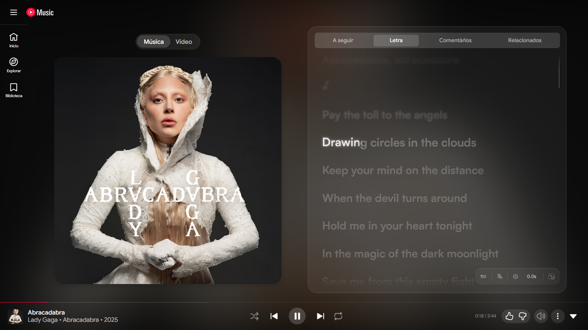
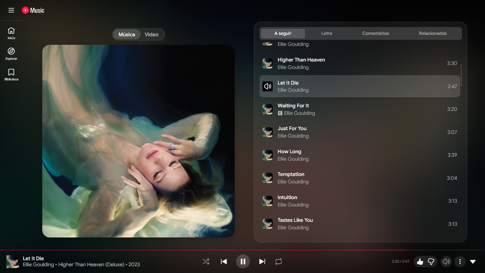
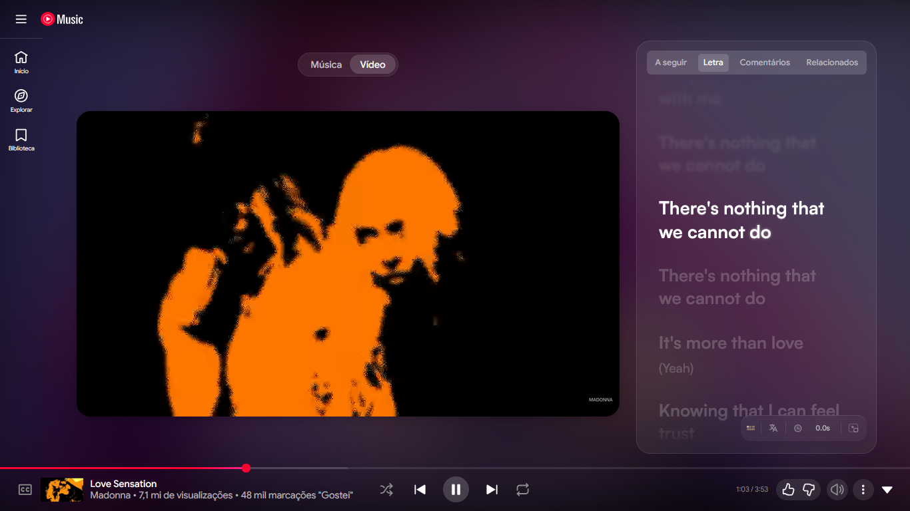
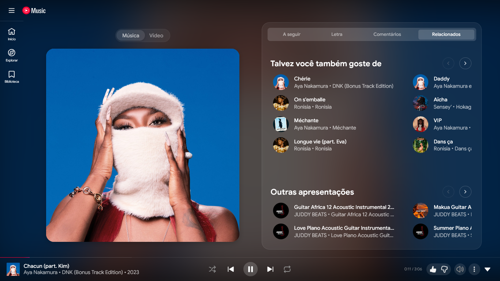

# Better Lyrics Modern Player

A clean and immersive YouTube Music theme featuring edge-to-edge album art, a unified glassmorphic side panel, a redesigned centered player bar, and a cinematic blurred background.

## Installation

1. Open Better Lyrics extension options
2. Go to **Themes** tab
3. Click **Install from URL**
4. Enter: `https://github.com/snw-mint/better-lyrics-modern-player`

## Preview

### Lyrics View

### Up Next / Queue

### Video Mode

### Related Content

## License

MIT
